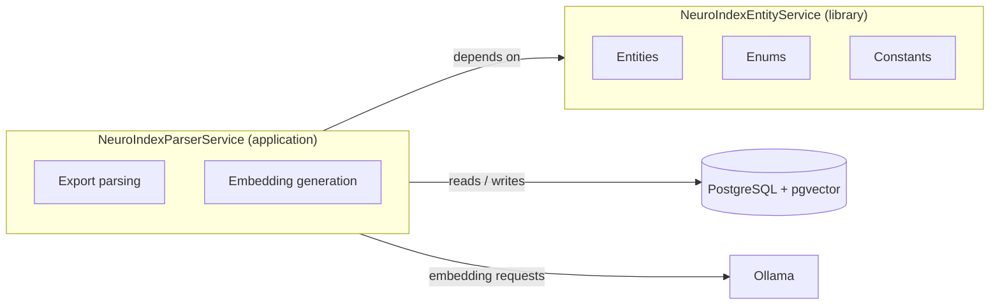
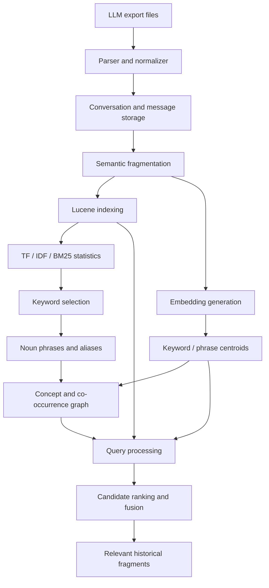

<div align="center">

# NeuroIndex

### A graph-aware retrieval engine for your scattered LLM memory

**Find the conversation, concept, or implementation detail you remember — without manually searching through hundreds of old prompts.**

[](https://www.java.com/)
[](https://spring.io/projects/spring-boot)
[](https://www.postgresql.org/)
[](https://github.com/pgvector/pgvector)
[](https://lucene.apache.org/)

</div>

---

## Table of contents

- [The problem](#-the-problem)
- [What NeuroIndex does](#-what-neuroindex-does)
- [Evaluation and benchmark notes](#-evaluation-and-benchmark-notes)
- [Repositories and services](#-repositories-and-services)
- [Architecture and data flow](#-architecture-and-data-flow)
- [Data model](#-data-model)
- [Implemented capabilities](#-implemented-capabilities)
- [Technology stack](#-technology-stack)
- [Retrieval mathematics](#-retrieval-mathematics)
- [Limitations and trade-offs](#-limitations-and-trade-offs)
- [Reproducing the setup](#-reproducing-the-setup)
- [Configuration checklist](#-configuration-checklist)
- [Future roadmap](#-future-roadmap)
- [Research references](#-research-references)

## 🧩 The problem

Conversations with large language models gradually become a personal knowledge base — but most chat interfaces are organized around individual conversations, not around the ideas distributed across them.

A developer may have discussed a data structure in one ChatGPT conversation, refined an implementation in another, and debugged a related issue in a third. Months later, remembering the topic is not enough: the user must also remember **which LLM, which conversation, and which of many prompts** contains the useful detail.

This creates several problems:

- **Fragmented knowledge:** related information is spread across conversations and platforms.
- **Expensive rediscovery:** users repeat research, explanations, and debugging they have already done.
- **Weak keyword recall:** the exact wording used in an old conversation may not match the wording of a new query.
- **Context loss:** useful implementation details become difficult to locate when a conversation is long or no longer accessible in the active context window.
- **Poor cross-conversation navigation:** conventional chat history search is not designed to connect recurring concepts across a user's entire archive.

NeuroIndex is an experimental retrieval system intended to turn exported LLM conversations into a searchable, structured knowledge base.

> **Core idea:** index the content at the fragment level, identify meaningful concepts and their relationships, and use lexical, semantic, and graph-oriented signals to retrieve relevant history.

## ✨ What NeuroIndex does

At a high level, NeuroIndex:

1. Ingests exported conversation histories. **Currently only Claude exports are supported.**
2. Parses conversations and preserves their source-level metadata.
3. Splits message content into semantic fragments suitable for indexing and retrieval.
4. Builds lexical indexes and extracts salient terms using term statistics.
5. Extracts noun phrases and maintains aliases that connect phrase-level concepts to useful keywords.
6. Creates and stores vector representations and centroid-like concept descriptors.
7. Organizes related concepts and fragments into a graph-oriented representation.
8. Combines retrieval signals to rank relevant historical fragments.

The system is designed around **retrieval of existing knowledge**, not generation of new answers. A language model can still be used downstream to summarize retrieved fragments, but that is separate from the core indexing and retrieval problem.

## 📊 Evaluation and benchmark notes

The project has been evaluated against a baseline semantic-search approach. The recorded results are:

| Metric | Baseline semantic search | NeuroIndex |
|---|---:|---:|
| MRR@3 | 0.556 | 0.759 |
| Average retrieval time | Baseline | Reported approximately 55% faster |

These figures are **project-reported experimental results**, not independently verified or universal performance guarantees.

- **MRR@3** rewards a system when the first relevant result appears near the top of the first three results; it assigns zero to a query when no relevant result appears within the cutoff (see [MRR@k](#9-mean-reciprocal-rank-at-k-mrrk) under Retrieval mathematics).
- The reported MRR@3 change is an absolute increase of **0.203**. Relative to 0.556, that is approximately **36.5% improvement**.
- “Approximately 55% faster” is meaningful only relative to the tested baseline, dataset, hardware, cache state, and measurement procedure.

For reproducible claims, publish the dataset size, query set, relevance labels, hardware, warm/cold-cache policy, number of repetitions, latency percentiles, and the exact baseline configuration. Avoid claiming that the same gain will hold for every corpus or workload.

## 🧱 Repositories and services

NeuroIndex is split across two repositories that are built and versioned separately:

| Repository | Role | Build tool |
|---|---|---|
| [**NeuroIndexParserService**](https://github.com/Ayush-Thakur-geek/NeuroIndexParserService) | Application service that handles the **parsing and embedding of LLM export data**. | Gradle (wrapper included) |
| [**NeuroIndexEntityService**](https://github.com/Ayush-Thakur-geek/NeuroIndexEntityService) | Shared **library** containing the **entities, enums, and constants** used by the other service(s), plus the database design. It is not a standalone runtime service. | Gradle (wrapper included) |

### How they relate



- **EntityService** defines the shared domain model (`users`, `llms`, `affiliated_emails`, `conversations`, `messages`, `semantic_nodes`, `semantic_fragments`, `semantic_fragment_node`, `semantic_edges`, `ingestion_jobs`) and its enums (for example message role, edge type, and ingestion status). Keeping these in a library gives every service the same view of the schema.
- **ParserService** consumes that library. It takes an LLM export, parses it into conversations and messages, and produces the embeddings that are stored alongside the fragments.

> **Note:** the sections below describe the end-to-end NeuroIndex pipeline. Individual stages (fragmentation, Lucene indexing, graph construction, retrieval) are described at the system level; consult each repository for exactly which module owns which stage in the current revision.

## 🏗️ Architecture and data flow



*The diagram describes the system's conceptual flow. Exact sequencing and the participation of each retrieval signal depend on the active implementation/configuration.*

### Ingestion and indexing

**Export → parse → persist → fragment → index**

- Conversation and message metadata are retained so retrieved content can be traced back to its origin.
- Content is divided into semantic fragments rather than treating an entire conversation as one large document.
- Fragment-level indexing enables a query to retrieve the specific part of a conversation that contains the relevant information.
- Apache Lucene supplies an inverted index and term statistics for lexical analysis and retrieval.
- PostgreSQL stores structured application data, while pgvector supports vector storage and similarity operations.
- Ingestion progress is tracked per affiliated account in an `ingestion_jobs` record (pending, processing, completed, failed).

### Concept representation

NeuroIndex does not rely on raw keywords alone. It uses noun phrases, aliases, keyword statistics, vector representations, and graph relationships to represent recurring concepts.

A phrase can have multiple useful aliases. For example, a conversation about “reciprocal rank fusion” may also contain “RRF,” “rank fusion,” or “combining ranked lists.” Aliases can improve matching without requiring every query to use the same surface form.

Centroid-like representations summarize the vectors associated with a concept. These can help connect related terms, but they are approximations: a centroid can blur distinct senses when a term is used in multiple contexts.

### Retrieval

Retrieval runs in two stages:

1. **Lexical entry points.** A Lucene fuzzy search over the indexed fragments/concepts returns scored lexical hits. Fuzzy matching tolerates typos and small wording differences in the query.
2. **Graph traversal.** The lexical hits become the *entry points* for traversing the concept graph (via `semantic_fragment_node` and `semantic_edges`), which surfaces related fragments that the lexical search alone would not return.

Not every entry point is chosen by strict relevance. Most are the top-scoring hits, but a few are drawn by **weighted random sampling without replacement** from the remaining hits. Higher-scoring hits are more likely to be picked, but lower-scoring ones still have a chance. This trades a little precision for broader coverage of the graph (see [Probabilistic entry-point sampling](#11-probabilistic-entry-point-sampling)).

The retrieval design combines complementary signals:

- **Lexical relevance** for exact terms and rare technical vocabulary.
- **Concept and alias matching** for alternate names and related phrases.
- **Graph relationships** for navigation between associated concepts and fragments.
- **Vector similarity** for semantic proximity where lexical overlap is insufficient.
- **Rank fusion** to combine result lists whose raw scores are not directly comparable.

This hybrid design aims to retain the precision of lexical search while improving discovery across differently worded conversations.

## 🗄️ Data model

The schema lives in the **NeuroIndexEntityService** repository (a dbdiagram.io definition and diagram are included there). Summary:

| Table | Purpose |
|---|---|
| `users` | Application users. |
| `llms` | An LLM provider linked to a user. |
| `affiliated_emails` | Accounts on a provider (with a Pro flag) from which exports originate. |
| `conversations` | Imported conversations (title, URL, unique content hash). |
| `messages` | Ordered messages per conversation with role (`USER`, `ASSISTANT`, `SYSTEM`), content, and hash. |
| `semantic_fragments` | Retrieval units cut from messages, with text, embedding, keywords, confidence score, and hash. |
| `semantic_fragment_node` | Join entity that makes fragments and nodes **many-to-many**. Each row links one fragment to one node and carries a `weight` (see below). |
| `semantic_nodes` | Concept nodes with a label, centroid vector, fragment count, average similarity, and stability flag. |
| `semantic_edges` | Links between nodes with a similarity score and an edge type (`SEMANTIC`, `TEMPORAL`, `CO_OCCURRENCE`). |
| `ingestion_jobs` | Status and progress of an import (`PENDING`, `PROCESSING`, `COMPLETED`, `FAILED`). |

Ownership chain: `users → llms → affiliated_emails → conversations → messages → semantic_fragments`, with fragments attached to concept nodes through `semantic_fragment_node`, and `semantic_edges` connecting node pairs.

### Fragment ↔ node relationship (`SemanticFragmentNode`)

A fragment can mention several concepts, and a concept appears in many fragments, so the relationship is many-to-many. It is modelled by an explicit join entity, `SemanticFragmentNode`, in the EntityService library:

| Field | Description |
|---|---|
| `fragment` | Lazy many-to-one reference to the `SemanticFragment` (`semantic_fragment_id`, required). |
| `node` | Lazy many-to-one reference to the `SemanticNode` (`semantic_node_id`, required). |
| `weight` | Relevance of the phrase node inside this fragment (required, default `1.0`). It can start as a BM25 score, keyword mass, or a constant `1.0`. |

Constraints and indexes on `semantic_fragment_node`:

- Unique constraint `uk_fragment_node` on (`semantic_fragment_id`, `semantic_node_id`), so a fragment is linked to a given node at most once.
- Indexes `idx_fragment_node_fragment` and `idx_fragment_node_node` for lookups in both directions (fragments of a node, nodes of a fragment).

Using an entity rather than a plain join table lets the link itself carry data (`weight`) that graph traversal and ranking can use.

> The schema declares embedding and centroid columns as `vector(1024)`. The configured embedding model must output vectors of exactly that dimension (see [Prepare the embedding model](#5-prepare-the-embedding-model)).

## ✅ Implemented capabilities

The following summarizes the capabilities developed in NeuroIndex. Individual modules and repository services may evolve independently.

- [x] **Claude export ingestion** — parses exported Claude chat histories. Claude is the only supported provider right now; the schema keeps a provider field per LLM so other providers can be added later.
- [x] **Fuzzy lexical entry points** — Lucene fuzzy search produces the candidate hits used to enter the graph.
- [x] **Probabilistic entry-point sampling** — temperature-weighted sampling without replacement picks some entry points by weighted probability rather than strict relevance, to increase coverage.
- [x] **Fragment–node many-to-many mapping** — the `SemanticFragmentNode` join entity links fragments to concept nodes with a per-link weight.
- [x] **Conversation and message persistence** — stores source metadata and parsed content in a relational schema.
- [x] **Semantic fragmentation** — breaks message content into smaller retrieval units.
- [x] **Lucene-based lexical indexing** — indexes fragments and exposes term/document statistics.
- [x] **TF/IDF-informed keyword scoring** — scores terms using their frequency and distribution across indexed fragments.
- [x] **BM25-based relevance scoring** — uses a term-based ranking function for keyword selection and lexical relevance.
- [x] **Adaptive keyword selection** — score-distribution-based selection avoids relying only on a fixed number of keywords for every fragment.
- [x] **Noun-phrase extraction and alias association** — represents concepts using phrases and associated keywords.
- [x] **Embedding-backed representations** — generates vectors for semantic comparison and concept descriptors.
- [x] **Centroid-like concept representations** — aggregates keyword-level vectors into compact descriptors.
- [x] **Graph-oriented concept associations** — represents keyword/concept relationships using co-occurrence and fragment mappings.
- [x] **Candidate ranking/fusion components** — supports combining ranked candidate lists using reciprocal-rank-based scoring.
- [x] **Persistent vector storage** — PostgreSQL with pgvector supports storing and comparing embeddings.
- [x] **Shared domain library** — entities, enums, and constants are factored into the separate EntityService repository.

> **Implementation note:** features such as NPMI edge weighting and confidence-gap fallback should only be described as active behavior if they are enabled in the checked-out revision. NPMI is documented below as a relevant association measure, but its presence in the runtime pipeline should be verified against the current code.

## 🧰 Technology stack

| Component | Technology | Purpose |
|---|---|---|
| Backend | Java, Spring Boot | Application services, ingestion orchestration, APIs, dependency injection |
| Build | Gradle (wrapper) | Building both repositories |
| Structured storage | PostgreSQL | Users, LLM affiliations, conversations, messages, fragments, and graph-related records |
| Vector storage | pgvector | Persisting embeddings and performing vector similarity operations inside PostgreSQL |
| Lexical index | Apache Lucene | Inverted indexing, term vectors/statistics, and BM25-based scoring |
| Embeddings | Ollama with a local embedding model | Producing vector representations for semantic similarity |
| Phrase extraction | Apache OpenNLP (where configured) | Noun-phrase extraction from text |
| Fast concept/cache data | Redis | Storing frequently used keyword, phrase, alias, or centroid mappings |
| Local infrastructure | Docker | Running reproducible supporting services such as PostgreSQL/pgvector |

### Why this combination?

- **PostgreSQL** keeps relational metadata and application records in a durable database.
- **pgvector** avoids requiring a separate vector database for the current prototype and supports vector operations in SQL.
- **Lucene** provides efficient inverted-index retrieval and term statistics, which are useful for technical terms, identifiers, and exact matches.
- **Embeddings** add a semantic signal that is not limited to identical words.
- **Redis** can keep frequently accessed concept mappings close to the application.
- **Java/Spring Boot** provides a structured service layer for ingestion, indexing, retrieval, and persistence.
- **A separate entity library** keeps the schema and enums consistent across services.

## 📐 Retrieval mathematics

The system combines established information-retrieval methods with application-specific selection and graph logic. The formulas below explain the concepts and the role they play; exact constants and implementation details should be checked against the code.

### 1. Term frequency (TF)

Term frequency measures how often a term occurs in a document or fragment. A basic form is:

$$
\mathrm{tf}(t,d) = f_{t,d}
$$

where $f_{t,d}$ is the count of term $t$ in fragment $d$.

**Why it matters:** repeated occurrence can indicate that a term is central to a fragment. However, raw frequency alone can overvalue common words or repeated boilerplate, so it is generally combined with collection-level statistics and normalization.

### 2. Inverse document frequency (IDF)

IDF reduces the importance of terms that occur in many documents and gives more weight to terms that are comparatively rare. A common smoothed definition is:

$$
\mathrm{idf}(t) = \log\frac{N+1}{\mathrm{df}(t)+1}
$$

where:

- $N$ is the number of indexed documents/fragments.
- $\mathrm{df}(t)$ is the number of documents/fragments containing $t$.

**Why it matters:** a technical identifier appearing in a few fragments can be more discriminative than a generic term appearing everywhere.

Different systems use different smoothing conventions. The formula above is illustrative; it should not be assumed to be the exact formula in every NeuroIndex scoring path.

### 3. TF–IDF

TF–IDF combines local frequency with global rarity:

$$
\mathrm{tfidf}(t,d) = \mathrm{tf}(t,d) \cdot \mathrm{idf}(t)
$$

**Role in NeuroIndex:** TF and IDF statistics help assess which terms are informative enough to represent a fragment or phrase. The actual keyword scoring pipeline also uses BM25-style scoring, rather than treating this simplified product as the only ranking function.

### 4. BM25

BM25 is a probabilistic information-retrieval ranking function that balances term frequency, inverse document frequency, and document-length normalization. A common form is:

$$
\mathrm{BM25}(d,q) = \sum_{t \in q} \mathrm{IDF}(t) \cdot \frac{f(t,d)\,(k_1 + 1)}{f(t,d) + k_1 \left(1 - b + b \cdot \dfrac{|d|}{\mathrm{avgdl}}\right)}
$$

where:

- $f(t,d)$ is the frequency of term $t$ in document $d$.
- $|d|$ is the document length.
- $\mathrm{avgdl}$ is the average document length.
- $k_1$ controls term-frequency saturation.
- $b$ controls document-length normalization.

A commonly used IDF variant (the one used by Lucene) is:

$$
\mathrm{IDF}(t) = \log\left(1 + \frac{N - \mathrm{df}(t) + 0.5}{\mathrm{df}(t) + 0.5}\right)
$$

**Why it matters:** repeating a term should help, but not without limit. Length normalization also prevents long fragments from winning solely because they contain more text. BM25 is used in NeuroIndex's lexical scoring and keyword-selection work.

### 5. Cosine similarity

For two non-zero vectors $a$ and $b$, cosine similarity measures the cosine of the angle between them:

$$
\cos(a,b) = \frac{a \cdot b}{\lVert a \rVert_2 \, \lVert b \rVert_2}
$$

For normalized vectors, the dot product equals cosine similarity. Cosine distance is commonly defined as $1 - \cos(a,b)$.

**Why it matters:** embeddings can place differently worded but semantically related fragments near each other. This can help retrieve content even when the query and historical text do not share the same keywords.

**Caveat:** vector similarity is not a guarantee of relevance. Broad concepts, overloaded terms, and imperfect embeddings can produce false positives. A vector dimension must also match the configured embedding model and database column.

### 6. Centroid aggregation

A simple centroid is the arithmetic mean of a set of vectors:

$$
\mathbf{c} = \frac{1}{m} \sum_{i=1}^{m} \mathbf{v}_i
$$

where $\mathbf{v}_i$ are the vectors being aggregated.

**Why it matters:** a centroid provides a compact descriptor for a keyword or concept based on associated representations.

**Trade-off:** a mean can drift as new examples are added, and it can blend multiple meanings into one representation. Centroids are summaries, not guaranteed semantic identities.

### 7. Normalized pointwise mutual information (NPMI)

Pointwise mutual information compares the observed joint probability of two events with the probability expected if they were independent:

$$
\mathrm{PMI}(x,y) = \log\frac{P(x,y)}{P(x)\,P(y)}
$$

Normalized PMI is commonly defined as:

$$
\mathrm{NPMI}(x,y) = \frac{\mathrm{PMI}(x,y)}{-\log P(x,y)}
$$

For valid co-occurrence probabilities, NPMI is generally bounded between $-1$ and $1$, subject to the treatment of zero counts and edge cases.

**Potential role in NeuroIndex:** score how strongly two concepts co-occur relative to their individual frequencies. This can be more informative than raw co-occurrence counts, since common concepts naturally appear together more often.

**Important distinction:** retaining co-occurrence counts does not itself mean NPMI has been computed. Treat NPMI-weighted graph edges as an enabled feature only when the current implementation calculates and uses this score.

### 8. Reciprocal Rank Fusion (RRF)

RRF combines multiple ranked result lists without requiring their raw scores to be on the same scale:

$$
\mathrm{RRF}(d) = \sum_{r \in R} \frac{1}{k + \mathrm{rank}_r(d)}
$$

where $R$ is the set of ranking lists, $\mathrm{rank}_r(d)$ is the rank of document $d$ in list $r$, and $k$ is a smoothing constant. The original paper uses $k = 60$ in its experiments.

**Why it matters:** BM25 scores and vector-similarity scores have different scales. RRF combines their ordering signals instead of naively adding incomparable raw scores.

**Role in NeuroIndex:** fuse candidates from independent retrieval paths when those paths are available. A fragment ranked highly by more than one method receives support from multiple lists.

### 9. Mean Reciprocal Rank at k (MRR@k)

The evaluation metric used in the benchmark section below:

$$
\mathrm{MRR@}k = \frac{1}{|Q|} \sum_{i=1}^{|Q|} RR_i,
\qquad
RR_i =
\begin{cases}
\dfrac{1}{\mathrm{rank}_i} & \text{if the first relevant result has } \mathrm{rank}_i \le k \\[2ex]
0 & \text{otherwise}
\end{cases}
$$

where $Q$ is the set of evaluation queries and $\mathrm{rank}_i$ is the position of the first relevant result for query $i$.

### 10. Score-distribution-based candidate selection

Rather than always selecting the same fixed number of terms, NeuroIndex uses score-distribution-based selection in its keyword extraction flow.

The general intuition is to select terms according to their relative scores and the shape of the observed distribution. This can adapt to fragments where several terms are similarly informative versus fragments where only a few terms stand out.

This is an **application-specific selection strategy**, not a standard probability model by itself. Unless the implementation explicitly normalizes scores into a probability distribution and samples from it, “probabilistic selection” should not be interpreted as calibrated probabilities or statistically guaranteed relevance.

### 11. Probabilistic entry-point sampling

After the Lucene fuzzy search, a subset of the lexical hits is sampled (rather than always taking the top-$k$) to seed graph traversal. Let the candidate hits have Lucene scores $s_i$, with $s_{\min}$ and $s_{\max}$ the lowest and highest scores in the pool.

**Step 1: min–max normalization.** Scores are rescaled to $[0,1]$ so the temperature does not depend on the absolute scale of Lucene scores:

$$
\tilde{s}_i =
\begin{cases}
\dfrac{s_i - s_{\min}}{s_{\max} - s_{\min}} & \text{if } s_{\max} > s_{\min} \\[2ex]
1 & \text{otherwise}
\end{cases}
$$

**Step 2: temperature-scaled weight.**

$$
w_i = \exp\!\left(\frac{\tilde{s}_i - 1}{T}\right), \qquad T > 0
$$

Subtracting 1 keeps the exponent non-positive, so $w_i \in (0, 1]$ and the best hit always has weight $1$. The weights are never zero for finite $T$, so even the lowest-scoring hit keeps a positive chance of being chosen.

**Step 3: selection probability.**

$$
p_i = \frac{w_i}{\sum_{j} w_j}
$$

One hit is drawn according to $p_i$ (inverse-CDF over the cumulative weights).

**Step 4: sampling without replacement.** The chosen hit is removed from the pool, and normalization, weights, and probabilities are recomputed on the remaining hits. This repeats until the requested number of entry points has been selected.

**Effect of the temperature $T$:**

| $T$ | Behaviour |
|---|---|
| Small | Weights fall off sharply with score; sampling approaches strict top-$k$ selection. |
| Large | Weights flatten; sampling approaches uniform selection over the pool. |

For example, at $T = 0.5$ the lowest-scoring hit ($\tilde{s}=0$) has weight $e^{-2} \approx 0.135$ relative to $1$ for the best hit.

**Validation and edge cases:**

- $T$ must be finite and greater than zero.
- The sample size must be between $0$ and the number of candidates; a size of $0$ returns an empty list.
- If all scores are equal, every hit gets $\tilde{s}_i = 1$ and sampling is uniform.
- If the total weight is not positive and finite, sampling fails with an error (increase the temperature).

**Why it matters:** strictly following relevance can trap traversal in one neighbourhood of the graph. Sampling lets lower-ranked but still plausible entry points seed traversal, which raises coverage at some cost in precision. As with any sampling strategy, results vary between runs unless the random source is seeded.

### Putting the methods together

| Signal | What it captures | Main weakness it helps address |
|---|---|---|
| TF / IDF / TF–IDF | Local repetition and global rarity | Generic terms dominating keyword selection |
| BM25 | Lexical relevance with saturation and length normalization | Raw term-count ranking |
| Cosine similarity | Semantic proximity in embedding space | Exact-wording dependence |
| Centroids | Aggregate concept representation | Repeated comparisons against every individual example |
| NPMI | Association beyond independent co-occurrence (when enabled) | Common terms creating misleadingly frequent edges |
| RRF | Agreement across ranked lists | Incompatible raw score scales |
| Adaptive score selection | Relative prominence of candidates | One fixed keyword count for every fragment |
| Temperature-weighted sampling | Probabilistic choice of graph entry points | Over-reliance on the top lexical hits; limited graph coverage |

## ⚠️ Limitations and trade-offs

NeuroIndex is an experimental retrieval system; it should not be treated as a lossless model of a user's knowledge or reasoning.

### Data and ingestion

- Only Claude exports are supported at the moment; exports from other LLM providers cannot be ingested yet.
- Export formats differ across providers and may change over time, including Claude's.
- Unsupported fields, attachments, images, audio, and other non-text payloads may not be represented in the same way as plain text.
- Duplicate detection and metadata normalization depend on the quality and stability of source exports.
- The user must export and ingest their histories; the system does not automatically have access to private LLM accounts.

### Retrieval quality

- Lexical methods can miss synonyms and paraphrases.
- Embeddings can retrieve semantically similar but contextually incorrect fragments.
- Keyword and noun-phrase extraction can miss unusual names, code identifiers, abbreviations, or domain-specific terminology.
- Alias propagation can introduce ambiguity when a short term has multiple meanings.
- Graph associations can amplify noisy co-occurrences.
- Centroids can drift or collapse distinct senses into a single representation.
- Rank fusion improves the combination of ranked lists but cannot rescue relevant content that all candidate generators missed.
- A score-distribution selector is sensitive to its thresholds and score shape; it should be evaluated on diverse fragment lengths and topic distributions.
- Sampled entry points make results non-deterministic unless the random generator is seeded, and the temperature trades precision against coverage; it should be tuned and evaluated, not assumed.
- Fuzzy matching can admit near-miss terms that are lexically close but unrelated, which then seed graph traversal.

### Performance and operations

- Ingestion, embedding generation, and graph construction can be compute-intensive for large histories.
- Repeated loading of shared graph or Redis state during batch processing can add avoidable overhead if not cached or batched efficiently.
- Vector dimensions and embedding-model changes must be managed consistently.
- Redis should be treated as a service dependency where required, with a defined recovery or rebuild strategy for derived state.
- Performance depends on corpus size, index configuration, storage, caching, and model choice.
- Because entities live in a separate library, a schema change requires releasing the EntityService first and then updating its consumers.

### Privacy and security

- Conversation exports may contain secrets, personal data, source code, or proprietary material.
- Keep credentials out of source control and restrict access to databases, Redis, and local embedding services.
- Review the retention and deletion behavior of raw exports, parsed messages, indexes, caches, and derived vectors before using sensitive data.
- Local inference can reduce reliance on external embedding APIs, but does not by itself guarantee that the whole deployment is secure.

## 🚀 Reproducing the setup

The exact commands depend on the configuration files in the version you are cloning. The steps below reproduce the known infrastructure and setup sequence without assuming unverified module names, endpoints, or application-specific CLI commands.

### Prerequisites

Install or prepare:

- A compatible JDK for the project's configured Java version.
- Git.
- Docker Engine and Docker Compose, if using containers for infrastructure.
- PostgreSQL with the pgvector extension, or the `pgvector/pgvector` Docker image.
- Redis if the selected application profile uses Redis-backed concept data.
- Ollama and the configured embedding model if embeddings are generated locally.
- Gradle is provided through the wrapper (`gradlew` / `gradlew.bat`) in each repository; no global install is needed.

Check each repository's `build.gradle` before choosing Java, framework, and dependency versions.

### 1. Clone both repositories

Clone them side by side:

```bash
git clone https://github.com/Ayush-Thakur-geek/NeuroIndexEntityService.git
git clone https://github.com/Ayush-Thakur-geek/NeuroIndexParserService.git
```

### 2. Build the EntityService library first

The ParserService depends on the entities, enums, and constants from the EntityService, so build it first:

```bash
cd NeuroIndexEntityService
./gradlew clean build
```

On Windows:

```powershell
.\gradlew.bat clean build
```

Then make the library resolvable by the ParserService in the way its `build.gradle` expects (for example, publishing it to your local Maven repository, or referencing it as a composite build). Check the dependency declaration in `NeuroIndexParserService/build.gradle` and follow that mechanism rather than assuming one.

### 3. Start PostgreSQL with pgvector

A local Docker instance can be created with the official pgvector image. For example:

```bash
docker run --name neuroindex-postgres \
  -e POSTGRES_DB=neuroindex \
  -e POSTGRES_USER=neuroindex \
  -e POSTGRES_PASSWORD=<LOCAL_PASSWORD> \
  -p 5432:5432 \
  -d pgvector/pgvector:pg17
```

Use a local development password only; do not commit it. For persistent data, configure a Docker volume or a Compose-managed volume.

Enable the vector extension in the target database:

```sql
CREATE EXTENSION IF NOT EXISTS vector;
```

The EntityService schema declares `vector(1024)` columns. The embedding model you configure must produce vectors of that dimension; do not assume every model does.

### 4. Start Redis, if required

If the application uses Redis for keyword, phrase, alias, or centroid mappings, start a Redis instance and configure the application to connect to it. A local container is one option:

```bash
docker run --name neuroindex-redis \
  -p 6379:6379 \
  -d redis:7
```

For anything beyond a local test, configure authentication, network restrictions, persistence, and an explicit recovery strategy appropriate to the deployment.

### 5. Prepare the embedding model

If the application uses Ollama locally, install Ollama and pull the embedding model configured in the ParserService. Use a model whose output dimension matches the schema (1024):

```bash
ollama pull <EMBEDDING_MODEL>
```

Verify that Ollama is running and that the application can reach its configured endpoint.

**Important:** changing the embedding model can change vector dimensions and vector-space semantics. Re-embedding existing data may be necessary; vectors from incompatible models should not be mixed as if they belonged to the same space.

### 6. Configure the ParserService

Inspect the repository's `application.yaml`, `application.yml`, `application.properties`, and environment-variable mappings. Set the database URL, credentials, Redis endpoint, embedding provider/model, and any required API settings using the names the application actually expects.

A **conceptual example only** (these names are placeholders, not guaranteed Spring property names):

```dotenv
DB_HOST=localhost
DB_PORT=5432
DB_NAME=neuroindex
DB_USER=neuroindex
DB_PASSWORD=<LOCAL_PASSWORD>

REDIS_HOST=localhost
REDIS_PORT=6379

# Configure the embedding provider and model
# according to the application's actual settings.
```

Do not paste these placeholder variable names into a production environment without mapping them to the application's real configuration. Keep secrets in environment variables or a local, ignored configuration file.

### 7. Build and run the ParserService

```bash
cd NeuroIndexParserService
./gradlew clean build
./gradlew bootRun
```

On Windows:

```powershell
.\gradlew.bat clean build
.\gradlew.bat bootRun
```

`bootRun` assumes the Spring Boot Gradle plugin is applied in the repository; use the entry point documented there if it differs. Use the active profile appropriate to your environment.

### 8. Initialize schema and indexes

Use the project's actual schema migrations or ORM configuration, driven by the EntityService definitions. Verify that:

- PostgreSQL tables are created.
- `vector` is enabled in the target database.
- Embedding columns have the expected dimensions.
- Required Lucene index directories are writable and point to the intended location.
- Redis keys/namespaces are consistent with the active configuration.
- The embedding model is available before starting ingestion.

Avoid manually creating a competing schema if the project already manages it through migrations or ORM configuration.

### 9. Ingest an export and validate retrieval

1. Obtain a Claude conversation export (the only format currently supported).
2. Use the ingestion entry point or API documented by the ParserService.
3. Confirm that conversations and messages are persisted and that the `ingestion_jobs` record reaches `COMPLETED`.
4. Confirm that fragments, lexical index entries, embeddings, and concept/graph data are created where expected.
5. Run a few queries with known answers in the archive.
6. Inspect the retrieved fragments and source metadata to ensure that the system returns the right context.

No ingestion endpoint or CLI command is specified here because its exact route and payload must come from the checked-out service's controller/API documentation.

### 10. Reproduce the benchmark

For a fair comparison with the recorded results:

- Use the same corpus and query set for both systems.
- Define relevance judgments before running the experiment.
- Warm up the application consistently.
- Run each query multiple times and report median and tail latency, not only a single average.
- Calculate MRR@3 from the same relevance judgments.
- Record hardware, model, embedding dimensions, index sizes, cache state, and software versions.
- Include indexing/ingestion costs separately from query latency.

## 🔧 Configuration checklist

Before treating a local deployment as reproducible, record the following:

- [ ] Java and Gradle versions (both repositories)
- [ ] EntityService version consumed by the ParserService
- [ ] PostgreSQL version and pgvector version
- [ ] Redis version and key namespace
- [ ] Embedding model name, version, and output dimension (must match the schema)
- [ ] Fragmentation and keyword-selection thresholds
- [ ] Fuzzy-search settings, number of entry points, sampling temperature, and random seed (if fixed)
- [ ] Lucene analyzer, BM25 parameters, and index location
- [ ] Graph edge construction and weighting method
- [ ] RRF constant and which candidate lists participate
- [ ] Database migration/version
- [ ] Supported export formats and a small test fixture
- [ ] Benchmark corpus, queries, relevance judgments, and evaluation script

## 🛣️ Future roadmap

These are future directions, not promises that the current build already supports them.

- **More LLM providers:** add export adapters beyond Claude (for example ChatGPT and others).
- **Browser extension:** ingest or save useful conversations with less manual export work.
- **Cross-LLM context transfer:** package relevant prior context for another model when a conversation reaches its token limit or work moves between providers.
- **More robust graph weighting:** validate and tune association measures such as NPMI, including smoothing, low-frequency edges, and noise handling.
- **Improved concept disambiguation:** address polysemy, alias collisions, and centroid drift.
- **Retrieval fallback and confidence estimation:** decide when graph/lexical retrieval is insufficient and when to invoke broader semantic search.
- **Incremental ingestion:** update only changed conversations and derived records instead of rebuilding unnecessary state.
- **Benchmark tooling:** automate relevance evaluation, ablations, latency measurement, and regression checks.
- **Operational hardening:** improve batching, caching, observability, error recovery, and index rebuild workflows.
- **Richer content support:** investigate code blocks, attachments, and additional export formats without losing source metadata.

## 📚 Research references

These references provide the theoretical foundations for the methods discussed above.

1. **Manning, Raghavan, and Schütze — *Introduction to Information Retrieval* (2008).** A foundational reference for inverted indexes, term weighting, TF–IDF, vector-space retrieval, and evaluation.  
   https://nlp.stanford.edu/IR-book/

2. **Robertson and Zaragoza — *The Probabilistic Relevance Framework: BM25 and Beyond* (2009).** Background on probabilistic relevance models and BM25.  
   https://doi.org/10.1561/1500000019

3. **Apache Lucene — `BM25Similarity` documentation.** Documents Lucene's BM25 implementation and its default parameters.  
   https://lucene.apache.org/core/9_4_0/core/org/apache/lucene/search/similarities/BM25Similarity.html

4. **Cormack, Clarke, and Büttcher — “Reciprocal Rank Fusion outperforms Condorcet and individual rank learning methods” (SIGIR 2009).** The original RRF publication.  
   https://doi.org/10.1145/1571941.1572114

5. **Bouma — “Normalized (Pointwise) Mutual Information in Collocation Extraction” (2009).** Discusses normalized PMI for measuring association between co-occurring terms.  
   https://svn.spraakdata.gu.se/repos/gerlof/pub/www/Docs/npmi-pfd.pdf

6. **Levy and Goldberg — “Neural Word Embedding as Implicit Matrix Factorization” (2014).** Useful background on the relationship between word embeddings and association statistics.  
   https://doi.org/10.1162/coli_a_00175

7. **pgvector — official repository and documentation.** Installation, vector types, distance operators, indexing, and PostgreSQL integration.  
   https://github.com/pgvector/pgvector

8. **Ollama — official documentation.** Local model execution and model management.  
   https://ollama.com/

9. **Apache OpenNLP — official project.** Natural-language processing tools, including phrase/chunk analysis capabilities.  
   https://opennlp.apache.org/

---

<div align="center">

**NeuroIndex — recover the context you already created.**

*An experimental project exploring more structured, graph-aware retrieval over personal LLM histories.*

</div>